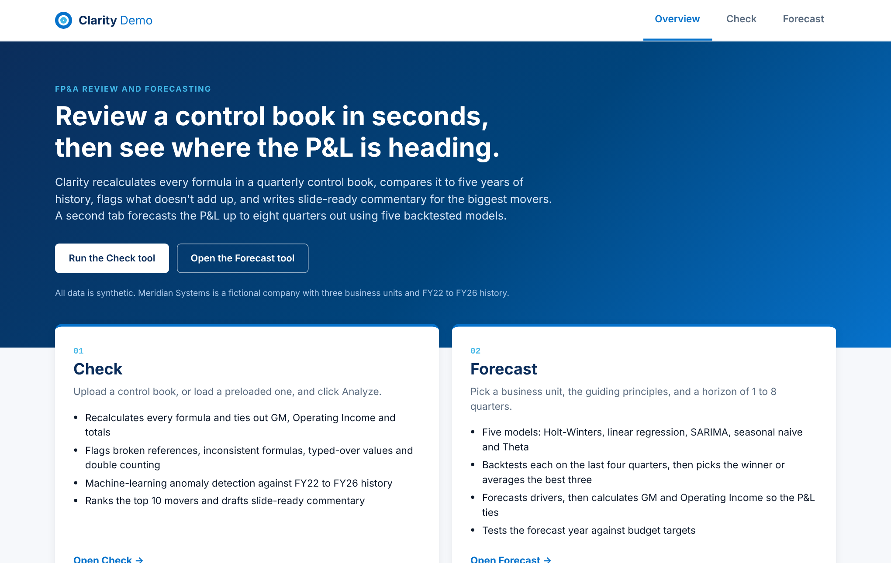
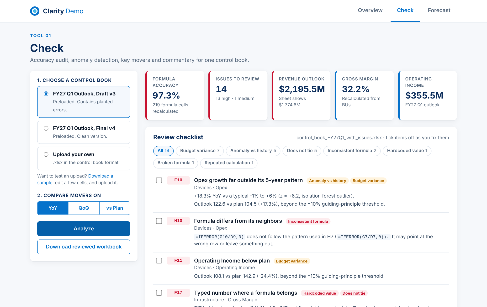
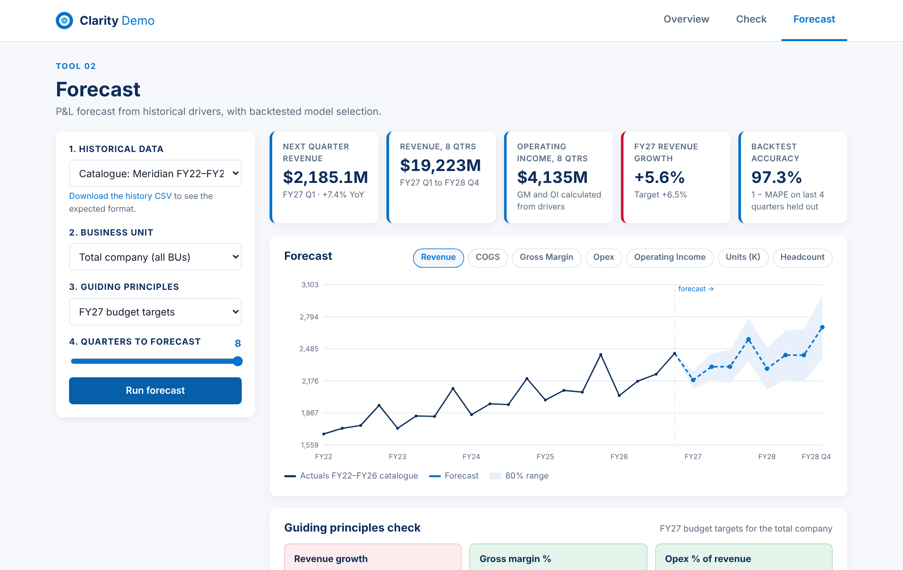

# Clarity Demo

**FP&A control book review and P&L forecasting, in one web app.**

**Live demo:** [clarity-demo-arvy.onrender.com](https://clarity-demo-arvy.onrender.com) (first load may take ~30 seconds)
Clarity takes a quarterly control book, recalculates every formula, compares the numbers to five years of history, and gives back a checklist of what doesn't add up. It also ranks the top movers and drafts slide-ready commentary for them. A second tab forecasts the P&L up to eight quarters out, using five models that are each backtested before the app picks which ones to trust.

> **About this project.** I designed the original version of Clarity during my Corporate FP&A internship. That version ran on internal data and can't be shared. This repo rebuilds the same approach from scratch, using a fictional company called **Meridian Systems** that anyone can open and test. Every number in this repo is synthetic.



---

## What it does

### Tab 1: Check

Upload a control book, or use one of the two preloaded ones, and click **Analyze**.

| Step | What happens |
|---|---|
| **Read** | The workbook is read twice: once for its formulas, once for the values Excel last displayed. |
| **Recalculate** | Every formula runs through Clarity's own evaluator (`app/formula_eval.py`), with no Excel needed. |
| **Audit** | Finds broken references (`#REF!`), formulas that differ from their neighbors, typed numbers sitting where formulas belong, cells counted twice, and displayed values that are stale. |
| **Tie out** | Checks that Gross Margin = Revenue − COGS, Operating Income = GM − Opex, and every Total = the sum of the business units. |
| **Compare to history** | Scores the outlook against FY22 to FY26 using a robust z-score of YoY growth plus an **Isolation Forest** (scikit-learn), which also catches cost lines moving out of step with revenue. Also flags any line that misses plan by more than the guiding-principle threshold. |
| **Explain** | Ranks the top 10 movers on a 50/50 blend of $ change and % change (YoY, QoQ or vs Plan), then writes one-line, slide-style commentary for each. |

It can also export the workbook with every flagged cell highlighted and annotated, plus a **Clarity Review** sheet you can use as a checklist.



### Tab 2: Forecast

Choose the historical data (the catalogue or your own CSV), a business unit, a set of guiding principles, and how many quarters to forecast (1 to 8).

- **Five models** per line item: Holt-Winters, linear regression with seasonality, SARIMA, seasonal naive with drift, and Theta.
- **Backtest selection:** each model is trained without the last four quarters and scored on them (MAPE). If one model is clearly the best (at least 20% lower error than the next), the app uses that model alone. If not, it averages the best three, weighted by accuracy.
- **Driver-based P&L:** Revenue, COGS, Opex, Units and Headcount are forecast directly. Gross Margin and Operating Income are calculated from those forecasts, never forecast on their own, so the P&L always ties.
- **Guiding principles check:** compares the forecast fiscal year's revenue growth, GM % and Opex ratio to that year's budget targets.



---

## Try it

**Preloaded data:**

| File | What's in it |
|---|---|
| `samples/control_book_FY27Q1_with_issues.xlsx` | Draft v3, with errors planted on purpose (see below) |
| `samples/control_book_FY27Q1_clean.xlsx` | Final v4, which should come back with zero issues |
| `data/history.csv` | Actuals for FY22 Q1 to FY26 Q4: 3 BUs × 7 lines × 20 quarters |
| `data/plan.csv` | Quarterly budget for FY22 to FY27 Q1 |
| `data/guiding_principles.csv` | Annual targets by BU: growth, GM %, Opex %, and the variance threshold |

**Errors planted in the draft book** (the test suite checks that every one is caught):

| Cell | Planted error | Flagged as |
|---|---|---|
| F17 | Infrastructure Gross Margin typed over with a stale number | Hardcoded value, Does not tie |
| H10 | Devices Opex QoQ % divides by the row above | Inconsistent formula |
| F31 | Total Revenue sum leaves out Software & Services | Inconsistent formula, Does not tie |
| F34 | Total Opex counts Devices twice | Repeated calculation |
| L20 | vs Plan % points to a deleted cell | Broken formula |
| F24 | Software & Services COGS +76% YoY | Anomaly vs history, Budget variance |
| F20 | Infrastructure Units −28% YoY | Anomaly vs history, Budget variance |
| F10 | Devices Opex 17% over plan | Anomaly vs history, Budget variance |

---

## Run it locally

```bash
git clone https://github.com/MalkamWallace/clarity-demo.git
cd clarity-demo
python -m venv .venv && source .venv/bin/activate   # Windows: .venv\Scripts\activate
pip install -r requirements.txt
uvicorn app.main:app --reload
```

Then open http://localhost:8000.

**AI commentary (optional).** Without an API key, commentary uses deterministic templates. To have Claude write it instead, set `ANTHROPIC_API_KEY` before starting the server. The model only sees numbers the engine has already calculated, and it is told not to compute anything new. If the call fails, the app falls back to the templates.

**Tests:** pip install pytest httpx && python -m pytest -q

**Regenerate the synthetic data:** `python scripts/generate_data.py` (LibreOffice is optional; it's only used to save the displayed values into the sample files).

## Deploy

The repo includes a `render.yaml` for one-click deployment on [Render](https://render.com) (free tier): **New → Blueprint →** pick this repo. I use Render instead of Vercel because the forecasting libraries (statsmodels, scikit-learn) go over Vercel's size limit for Python functions.

## Project layout

```
app/
  main.py          FastAPI routes and the reviewed-workbook export
  checker.py       Check tool pipeline
  formula_eval.py  Safe Excel formula parser and evaluator
  anomaly.py       Robust z-score + Isolation Forest, plan variance
  commentary.py    Template and Claude commentary
  forecaster.py    Five models, backtest selection, P&L rollup
  data_store.py    Loads the catalogue (history, plan, guiding principles)
static/            Plain HTML, CSS and JS frontend (no build step)
data/              Synthetic catalogue
samples/           Preloaded control books
scripts/           Data generator
tests/             pytest suite
```

## Design choices

- **Automate the labor, never the judgment.** All the math happens in code. The language model only writes sentences.
- **Every flag explains itself.** Each issue shows the formula, the expected value, and how far off it is, so a reviewer can verify it in seconds.
- **The P&L has to tie.** The forecast never predicts margin lines directly. They are calculated from the forecast drivers.
- **No Excel needed.** Formulas are recalculated with a small built-in parser, so the app runs anywhere Python does.

## Limitations

- The formula evaluator handles common control book functions (SUM, IF, IFERROR, ROUND, AVERAGE, MIN, MAX, ABS). Anything else gets reported as unsupported, never guessed.
- The anomaly model is trained on 16 to 20 points per series, which is fine for a demo but thin for production use.
- The forecasts use internal drivers only. Market signals, like industry growth or macro data, would be the next input to add.
